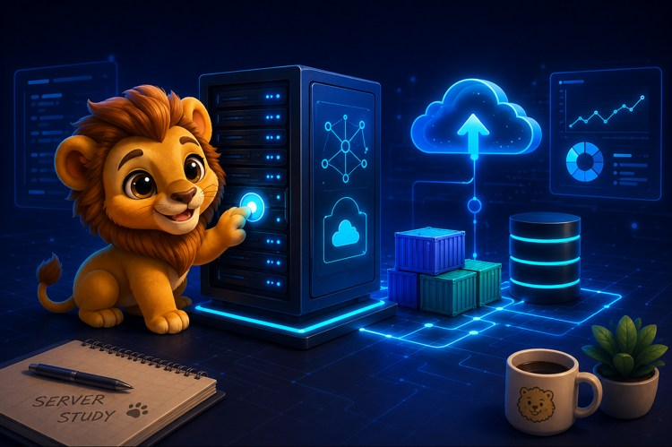
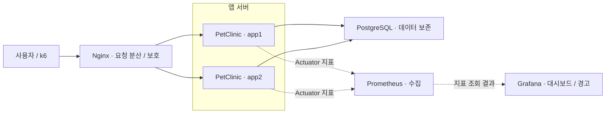

# Server Engineering Study

### 배포 크게 배포하시조 · 멋쟁이사자처럼 서버 엔지니어링 1조

**서버 실행부터 데이터 보존, 요청 제어, 장애 대응과 모니터링까지.**

Spring PetClinic을 하나의 실습 대상으로 삼아, 서비스를 배포하고 운영하는 데 필요한 구성을 8회차에 걸쳐 확장한 스터디입니다. 이 Repository에서는 주차별 학습 흐름과 실습 결과를 정리하고, 공동 Repository와 상세 기록을 연결합니다.

[스터디 Organization](https://github.com/likelion-server-study) · [전체 Notion 기록](https://app.notion.com/p/1-bdbac3ee3cde83f7977901a38a6758fa) · [주차별 자료](#주차별-학습과-자료) · [나의 역할](#나의-역할)

## 스터디 소개

| 항목 | 내용 |
| --- | --- |
| 기간 | 2026.07.10 OT · 2026.07.14–08.31, 총 8회차 |
| 구성 | 스터디장 포함 4명 |
| 진행 방식 | 담당자가 이론·실습 자료를 준비하고, 함께 실습한 결과와 오류 해결 과정을 기록 |
| 실습 대상 | Spring PetClinic, Docker 기반 서비스 구성 |
| 목표 | 실행 여부를 확인하는 단계에서 출발해 데이터를 보존하고, 요청을 보호하고, 장애와 성능 변화를 관찰하는 운영 구조 이해 |

## 나의 역할

스터디장으로서 매주 미리 볼 예습 자료를 별도로 만들고, 핵심 개념과 실습 방향을 정리해 공유했습니다. 팀원들이 어떤 내용을 먼저 이해하고 무엇을 준비해야 하는지 파악한 뒤, 같은 방향으로 스터디를 준비할 수 있도록 학습 흐름을 잡았습니다.

- **주차별 예습과 학습 방향 정리:** 회차별 핵심 질문과 사전 학습 내용을 정리하고, 이전 회차의 실습이 다음 주제로 어떻게 이어지는지 안내했습니다.
- **실습과 기록의 연결:** 이론을 실습에서 확인할 항목으로 연결하고, 실행 결과와 오류 해결 과정을 Notion·GitHub에 남기며 함께 참고할 수 있도록 했습니다.
- **4회차 — Nginx 자료 준비 및 진행:** 리버스 프록시, 내부 네트워크 분리, 정적 파일 캐시, 요청 제한과 보안 설정을 다뤘습니다. 환경 설정·이론·실습·트러블슈팅·결과 기록으로 자료를 구성했습니다.
- **8회차 — AWS 연결 학습 준비 및 진행:** Docker·Nginx·PostgreSQL·로드밸런싱·모니터링 실습을 VPC, EC2, RDS, ALB, CloudWatch 등의 개념과 연결해 정리했습니다.

[4회차 GitHub 자료](https://github.com/likelion-server-study/WEEK4) · [4회차 Notion](https://app.notion.com/p/8-4-4-3b0ac3ee3cde80219946ff46fcd692e4) · [8회차 Notion](https://app.notion.com/p/8-31-8-3c9ac3ee3cde80bfb733f942c6486b34)

## 서비스 구성

5–6회차에서 다룬 서비스 경로와 모니터링 관계를 요약한 개념도입니다.

실선은 사용자 → Nginx → PetClinic → PostgreSQL로 이어지는 요청 경로입니다. 점선은 앱 지표가 Prometheus를 거쳐 Grafana에서 시각화되는 정보 흐름입니다. 실제 수집은 Prometheus가 각 앱의 Actuator 지표를 주기적으로 조회하고, Grafana가 Prometheus에 질의하는 방식으로 동작합니다.

Kubernetes는 7회차에 별도 기초 실습으로만 다뤘습니다. 

## 주차별 학습과 자료

| 회차 | 일자 | 핵심 주제 | 코드·실습 자료 | 학습 기록 |
| --- | --- | --- | --- | --- |
| 1 | 07.14 | 서버 실행, 프로세스·포트·로그 확인 | [WEEK1](https://github.com/likelion-server-study/WEEK1) | [Notion](https://app.notion.com/p/7-14-1-39dac3ee3cde80edac8dd93474081b13) · [PDF](docs/week01.pdf) |
| 2 | 07.21 | Docker 이미지·컨테이너, 실행 환경 통일 | [WEEK2](https://github.com/likelion-server-study/WEEK2) | [Notion](https://app.notion.com/p/7-21-2-3a2ac3ee3cde807586fff1df3f134674) · [PDF](docs/week02.pdf) |
| 3 | 07.29 | PostgreSQL, 데이터 보존과 트랜잭션 | [WEEK3](https://github.com/likelion-server-study/WEEK3) | [Notion](https://app.notion.com/p/7-29-3-3abac3ee3cde80e3a4a7c8ef75557ede) · [PDF](docs/week03.pdf) |
| **4** | **08.04** | **Nginx, 리버스 프록시, 캐시와 요청 보호** | [WEEK4](https://github.com/likelion-server-study/WEEK4) | [Notion](https://app.notion.com/p/8-4-4-3b0ac3ee3cde80219946ff46fcd692e4) · [PDF](docs/week04.pdf) |
| 5 | 08.13 | 다중 앱 구성, 로드밸런싱과 장애 우회 | [WEEK5](https://github.com/likelion-server-study/WEEK5) | [Notion](https://app.notion.com/p/8-13-5-3bbac3ee3cde80e29c06d7da5b1f48c0) · [PDF](docs/week05.pdf) |
| 6 | 08.18 | Actuator, Prometheus, Grafana와 부하 테스트 | [WEEK6](https://github.com/likelion-server-study/WEEK6) | [Notion](https://app.notion.com/p/8-18-6-3c0ac3ee3cde8024a23af66b260fd381) · [PDF](docs/week06.pdf) |
| 7 | 08.28 | Kubernetes 기초와 YAML 기반 구성 관리 | [WEEK7](https://github.com/likelion-server-study/WEEK7) | [Notion](https://app.notion.com/p/8-28-7-3c9ac3ee3cde8042aea3e7992198c87a) · [PDF](docs/week07.pdf) |
| **8** | **08.31** | **기존 운영 구조와 AWS 서비스 연결 학습** | [WEEK8](https://github.com/likelion-server-study/WEEK8) | [Notion](https://app.notion.com/p/8-31-8-3c9ac3ee3cde80bfb733f942c6486b34) · [PDF](docs/week08.pdf) |

회차별 스터디 기록을 PDF로도 첨부하여 Notion 접근 권한 없이 확인할 수 있도록 했습니다.

각 WEEK Repository에서 해당 회차의 코드·설정·실행 방법을 확인할 수 있습니다. 이 Repository는 전체 활동을 안내하는 문서 저장소이며, 공동 실습 코드는 원본 Repository에서 관리합니다. Notion 문서는 공유 설정에 따라 로그인이 필요할 수 있습니다.

## 운영 실습에서 확인한 것

| 영역 | 구성 및 확인 내용 |
| --- | --- |
| 실행·로그 | 프로세스, 포트, `curl`, 콘솔·파일 로그로 서버 실행 여부와 오류 위치 확인 |
| 컨테이너 | 포트 매핑, 상태·로그 조회, CPU·메모리 제한, 이미지 저장·공유, 자동 재시작 |
| 데이터 보존 | PostgreSQL을 별도 컨테이너로 분리하고 Named Volume으로 데이터 유지 |
| 트랜잭션 | `BEGIN`·`ROLLBACK`을 통한 DB 변경 처리와 되돌리기 |
| 요청 경로 | Nginx만 외부 입구로 공개하고 앱·DB는 내부 네트워크에서 통신 |
| 캐시 | 정적 파일 요청의 `MISS`·`HIT`를 비교하고 앱으로 전달되는 요청 관찰 |
| 요청 보호 | 과도한 요청 `429`, 큰 요청 `413`, 메서드 제한 `405`, 경로 차단 `403` 확인 |
| 장애 대응 | app1·app2로 요청 분산, 앱 중단 시 다른 앱으로 요청 우회 |
| 장애 안내 | 모든 앱이 중단되면 안내 화면을 제공하되 `502` 유지, 재시작 후 복구 확인 |
| 관측 | Nginx·Tomcat·PostgreSQL 로그 비교, Actuator·Micrometer 지표 수집 |
| 모니터링 | Prometheus 지표 수집, Grafana 대시보드·경고, k6 부하 테스트 |
| 구성 관리 | ConfigMap·Secret·앱·DB를 YAML로 선언하고 `kubectl apply` 적용 |

세부 실행 결과와 실습 과정은 각 회차 기록에서 확인할 수 있습니다.

## 상세 정리

- [운영 실습 요약과 결과 확인 기준](docs/operations.md)
- [기존 실습과 AWS 서비스의 연결](docs/aws-mapping.md)
- [전체 학습 기록 및 회차별 원문](https://app.notion.com/p/1-bdbac3ee3cde83f7977901a38a6758fa)

## 기술과 참고 자료

**서비스:** Spring Boot · Spring PetClinic · Tomcat · PostgreSQL  
**배포·요청 제어:** Docker · Docker Compose · Nginx  
**관측·검증:** Micrometer · Actuator · Prometheus · Grafana · k6  
**확장 학습:** Kubernetes · AWS

- [Spring PetClinic](https://github.com/spring-projects/spring-petclinic)
- [Docker Compose](https://docs.docker.com/compose/)
- [Nginx proxy module](https://nginx.org/en/docs/http/ngx_http_proxy_module.html)
- [KAIST SPARCS](https://sparcs.org/)
- 이것이 리눅스다
- 그림으로 이해하는 서버 구조와 기술
